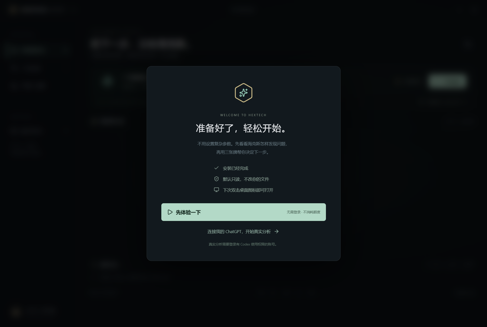
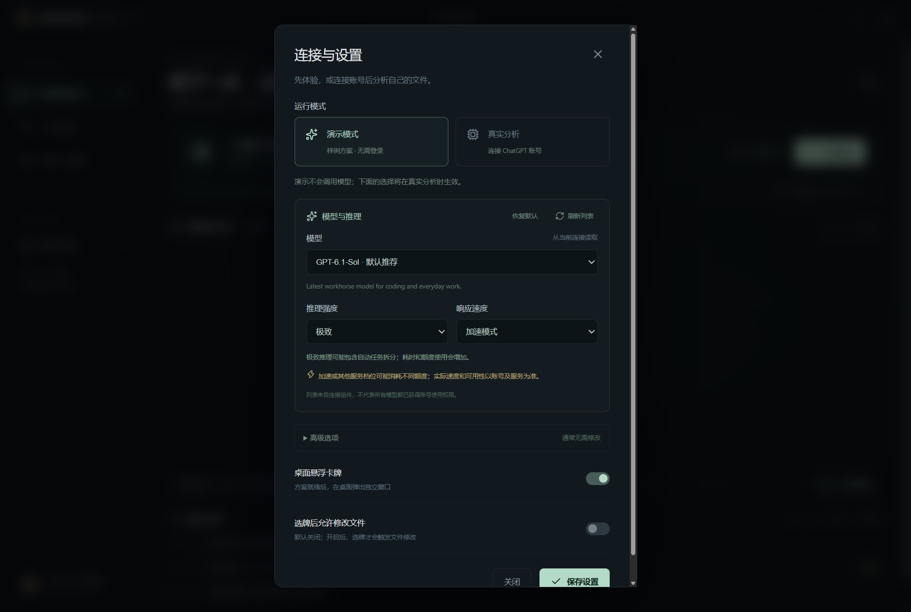

# 海克斯 Agent

**让桌面上的代码和工作资料，变成可以选择的下一步。**

海克斯 Agent 是一个使用 Electron、Vite、TypeScript 和 Vue 3 开发的 Windows 桌面 Demo。它持续监听指定目录，把文件变化交给本机 Codex 分析；发现有依据的问题后，以三张方案卡呈现结果。用户选牌后，再决定继续深入，还是寻找下一个问题。

安装包自带 Electron 运行环境和官方 Codex 连接组件，不需要 Node.js、命令行或额外安装 Codex。可以直接体验，也可以在软件里点击「登录 ChatGPT」，通过浏览器连接账号后开始真实分析。


## 核心流程

```text
监听桌面 / 指定目录
        ↓
优先检查新文件、新文件夹和内容修改
        ↓
Codex 判断是否涉及新任务或实际问题
        ↓
生成三个完整方案，再展示三张卡牌
        ↓
用户选择方案 → 生成报告，或在开启可写模式后执行修改
        ↓
两张后续卡牌：继续深入 / 继续巡检
        ↓
重复；手动停止、关闭应用或额度耗尽时结束
```

当前正在展示的卡牌会保留，后台的新发现进入待看列表。新动作可以打断后台分析；正在执行的选定方案会先完成本轮处理。

## 已实现

| 能力 | 当前行为 |
| --- | --- |
| 持续监听 | 递归监听所选目录，文件写入稳定后入队 |
| 新动作优先 | 新文件、新文件夹和内容更新进入优先队列 |
| 三选一方案 | 收齐三个完整且不同的方案后才展示卡牌 |
| 桌面悬浮窗 | 独立置顶窗口，可收起，也可关闭并终止任务 |
| 后续选择 | 生成报告后，选择继续深入或继续巡检 |
| Codex 接入 | 通过 App Server 的 stdio 协议复用本机登录与配置 |
| 额度停止 | 读取账号额度；检测到耗尽或相关错误时停止循环 |
| 只读优先 | 默认生成报告，手动开启后才允许选牌触发文件修改 |
| 演示模式 | 固定样例判断，无需登录，不消耗模型额度 |

## 先运行起来

### 使用 Windows 应用

从 [Releases](https://github.com/Tianlang-2000/hextechAgent/releases) 下载 `Hextech-Agent-Setup-0.3.0-x64.exe`，双击后按中文安装向导完成安装。默认创建「海克斯 Agent」桌面图标和开始菜单入口；以后双击图标即可打开，也可从 Windows 设置中卸载。

首次打开会显示欢迎引导，点击「先体验一下」即可开始，不需要登录，也不消耗额度。打开左侧演示文件夹，添加 Markdown、文本或代码文件，可以观察新动作优先。



安装包当前未进行 Windows 代码签名，系统可能显示发布者未验证提示；请核对下载来源和发布页提供的 SHA256 校验值。

### 从源码启动

需要 Windows x64，以及 Node.js 24 LTS 和 npm。

```sh
npm ci
npm run dev
```

也可以构建后启动：

```sh
npm run build
npm start
```

项目根目录的 `启动海克斯.cmd` 会优先运行本地打包版；没有打包版时，使用已安装的 Electron 启动。

## 使用真实 Codex

1. 在欢迎页选择「连接我的 ChatGPT」，或打开「连接与设置」选择「真实分析」。
2. 点击「登录 ChatGPT」，在自动打开的浏览器中完成授权；已有可复用登录时会直接显示就绪。
3. 返回软件，选择要检查的目录，点击「开始真实巡检」。真实分析需要账号有 Codex 使用权限，会使用账号额度。

在「连接与设置 → 模型与推理」可以选择模型、推理强度和响应速度。列表从当前连接读取，只展示对应模型支持的档位；默认跟随连接配置。更改前先停止巡检，保存后重新开始，设置会保留到下次启动。程序路径仍在「高级选项」。

标准速度会覆盖已有的加速配置；加速仅在模型目录提供时出现，可能消耗更多额度，实际速度及权限以账号和服务为准。问题分析与选牌处理都会使用相同设置。



这里会启动独立的本机 Codex App Server 进程，复用本机登录。已有桌面聊天窗口和历史对话不会作为连接入口。接入实现与版本兼容说明见 [Codex 接入](docs/codex-integration.md)。

## 只读报告与文件修改

默认选牌后生成详细的 Markdown 报告，包括建议改法、执行步骤和验证方法。**生成报告不代表文件已经修复。**

需要实际修改时，先停止巡检，再开启「选牌后允许修改文件」。只有用户选牌才会触发可写回合。每次重新启动应用，这个开关都会恢复关闭。

在真实模式中，文件节选、问题描述和必要上下文会交给 Codex 使用的模型服务处理。扫描过滤策略与 Codex 工具沙箱是不同层次的约束，具体范围见 [使用指南](docs/usage.md)。

## 当前范围

- 主要面向 Windows x64；其他系统尚未完成桌面端到端验证。
- 支持 Markdown、文本、CSV/JSON 和常见代码格式，暂不解析 Office、PDF、图片或压缩包。
- 最多索引 2000 个可读文件；跳过超过 256 KB 的文件，每轮最多读取前 16000 字节。
- 同时只处理一个模型回合；写入稳定 800 毫秒后触发，空闲时约 45 秒后再次轮转复查同一文件。
- 普通后台分析会在待看发现达到 8 个时暂停，新动作仍优先检查。
- 单次模型回合最多等待 5 分钟；连接异常或额度耗尽后，需要处理原因并手动重启巡检。
- 演示模式的判断是固定示例，界面和报告都会标记，不能作为真实诊断使用。

## 文档

| 文档 | 内容 |
| --- | --- |
| [使用指南](docs/usage.md) | 演示体验、目录选择、卡牌操作、报告与停止 |
| [Codex 接入](docs/codex-integration.md) | 登录复用、连接检查、协议与额度 |
| [架构说明](docs/architecture.md) | 进程边界、任务调度、状态流转 |
| [开发与打包](docs/development.md) | 本地开发、测试、Windows 构建与发布 |
| [常见问题](docs/faq.md) | 登录、连接、监听与下载问题 |
| [更新记录](CHANGELOG.md) | 版本变化与验证范围 |

## 开发命令

```sh
npm test                         # 行为测试，不调用真实模型
npm run build                    # 类型检查与构建
npm run test:desktop             # Electron 完整演示流程，输出截图
npm run check:codex              # 检查登录、连接与额度，不发起模型任务
npm run check:codex -- --analyze  # 对固定示例发起一次真实分析，消耗额度
npm run package:dir              # 生成 Windows 解压即用目录
npm run package                  # 生成 Windows 中文安装包与桌面快捷方式
npm run test:installer           # 安装、快捷方式、安装版启动与卸载测试
```

## 项目状态

当前已发布安装版为 `0.3.0`。源码后续增加了复查频率、每日调用次数上限、当前问题和报告恢复、证据原文匹配；这些新增功能尚未打包发布。更多文档格式、处理结果复核和更完整的连接恢复仍待完善。
