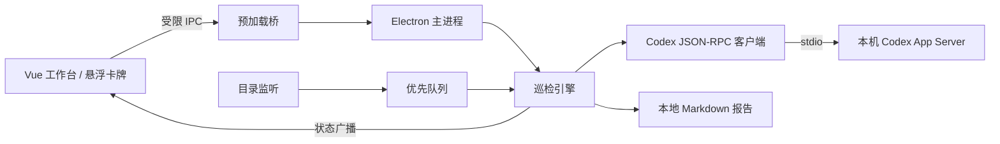
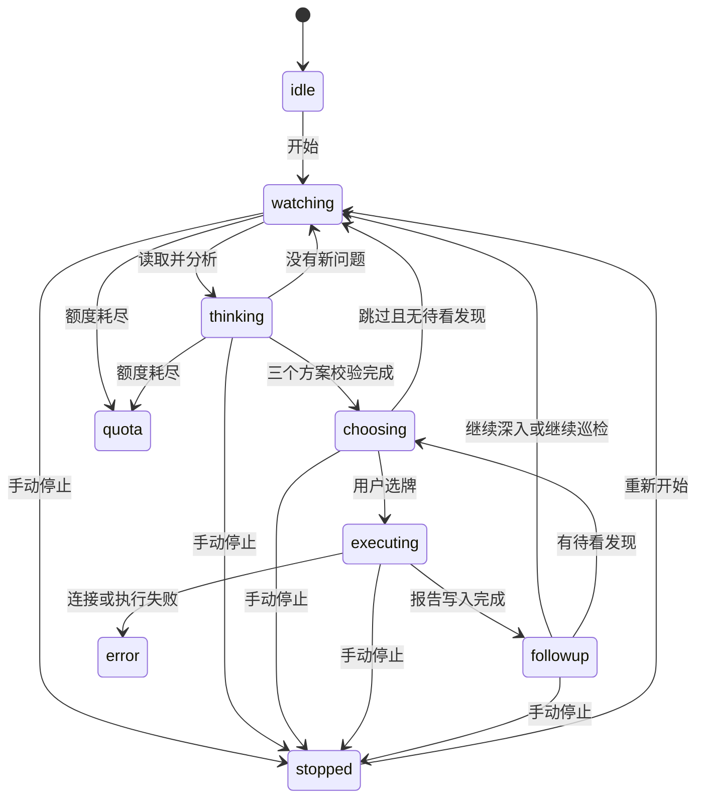

# 架构说明

## 进程与职责

| 模块 | 职责 |
| --- | --- |
| `electron/main.ts` | 创建窗口、注册 IPC、保存设置、打开报告 |
| `electron/preload.ts` | 暴露状态读取、状态订阅、动作调用和目录选择 |
| `electron/engine.ts` | 目录监听、任务循环、去重、方案处理和停止 |
| `electron/codex.ts` | 程序定位、连接、JSON-RPC、模型回合与额度 |
| `electron/connection.ts` | 图形化账号检查、浏览器登录、取消和登录通知 |
| `electron/policy.ts` | 路径边界、文件过滤与任务队列 |
| `electron/schema.ts` | 方案输出结构及运行时校验 |
| `electron/demo.ts` | 固定演示判断与可取消等待 |
| `src/App.vue` | 工作台、三方案、两张后续卡牌、设置与报告 |
| `src/shared.ts` | 主进程和渲染层共用的数据类型 |

## 目录监听与任务优先级

启动时，Chokidar 递归建立文件索引。初始文件按普通优先级排队；初始化完成后的新增和修改事件按高优先级排队。

队列以路径作为键，同一路径的重复动作会合并。高优先级任务先取出，同优先级按入队时间处理。

如果新动作到达时正在后台分析，取消当前回合并将原任务放回队列。方案执行回合不会被新文件事件打断。

没有排队任务时，引擎按设置的间隔复查已有文件，也可设为仅检查新增和修改。文件节选未变化时跳过模型调用；主动深入仍会分析。

## 发现、去重与待看列表

读取文件节选后，演示实现或真实 Codex 返回分析结果。真实模式会先通过输出结构校验。

发现指纹由来源路径、问题标题、当前内容及主动深入上下文计算。同一指纹不会重复出牌；标题变化或内容变化仍可能形成新的发现。

已有卡牌时，后续结果进入待看列表，新动作相关结果放在前面。待看达到 8 个时暂停普通分析；高优先级任务仍可继续，因此 8 不是待看列表的绝对上限。

## 状态流转

状态图展示主要路径，额度与连接错误也可能发生在其他活动状态。引擎一次只运行一个模型操作；界面保持选牌状态时，后台仍可分析其他文件。

## 取消与旧结果隔离

每次启动或停止都会改变运行代次。异步任务完成时校验代次，丢弃上一次运行的结果，避免停止后又出牌。

分析和执行分别持有取消信号。停止时关闭定时器、目录监听及 Codex 连接。Windows 下，客户端还会调用系统进程终止工具处理 App Server 的子进程树。

## 窗口与 IPC

主界面和悬浮窗使用同一个 Vue 应用，通过页面片段区分呈现方式，共用主进程中的状态。渲染进程关闭 Node.js 集成，启用上下文隔离和沙箱，通过预加载层调用有限的应用接口。

新窗口请求被拒绝，外部导航被阻止。主窗口或悬浮窗的关闭操作都会退出应用；悬浮窗的收起操作只隐藏窗口。

## 当前持久化范围

持久化内容仅包括设置、演示素材和已生成的报告。队列、待看发现、活动记录及去重集合位于内存中；重新启动巡检时重建索引并重新检查。

## 安装与运行组件

NSIS Setup 安装包负责程序文件、海克斯图标、桌面及开始菜单快捷方式和卸载注册。卸载默认保留用户数据，重装无需丢失报告。

构建时从锁定的官方 npm 平台包准备 Codex 组件，作为安装资源分发，优先于用户 PATH 中的旧安装。组件许可证及声明一同放在资源目录，不复制开发机的账号配置。

首次打开显示欢迎引导，用户可点击体验或进入图形化登录。登录管理器使用独立连接完成账号检查和官方浏览器授权，不发起模型任务；后台巡检只在用户主动开始后运行。
